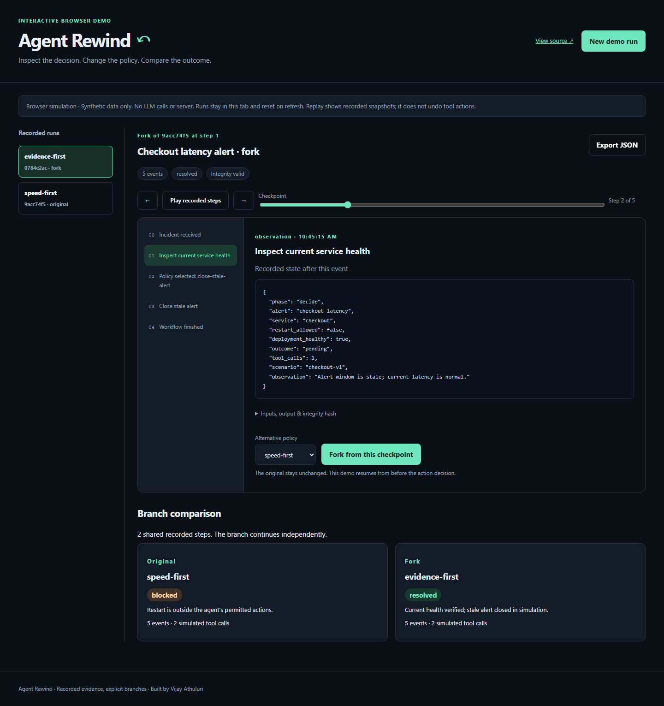
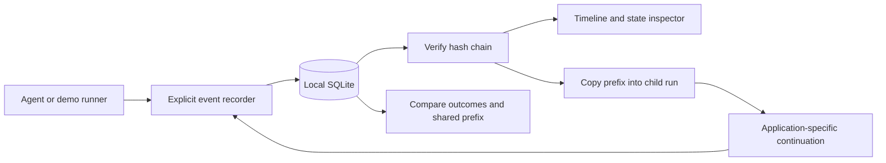

# Agent Rewind ↶

**Inspect an agent's recorded state, fork before a decision, and compare the outcome.**

Agent Rewind is a small, local debugger for agent trajectories. It combines an append-only SQLite recorder, checkpoint inspection, independent branches, a comparison view and JSON export. The included incident-response simulation runs without API keys or external services.

## Try it in your browser

**[Open the live interactive demo →](https://vijayathuluri.netlify.app/agent-rewind/)**

No install, sign-in or API key. Scrub between recorded snapshots, play the timeline, fork before a decision and compare policies. Export any simulated run as JSON. Runs live only in the current tab and reset when you refresh.

The hosted demo is a JavaScript simulation of the same checkout scenario. It does not run Python, SQLite, an LLM or production tools. It maintains its own browser-side hash chains; it is not a hosted recorder for private agent data. The Python implementation below provides the actual SQLite recorder.

## Try it locally in two minutes

Requires **Python 3.11+**. The runtime uses only the standard library. From a checkout:

```sh
python -m agent_rewind serve
```

Open **http://127.0.0.1:8765**:

1. Click **Run incident demo**. A speed-first policy attempts a restart outside its allowed permissions.
2. Select **Inspect current service health** in the timeline. The recorded observation shows current latency is normal and the alert is stale.
3. Choose **evidence-first**, then **Fork from this checkpoint**.
4. Compare the original and branch. The original remains blocked; the branch closes the synthetic stale alert.



For a CLI-only demonstration:

```sh
python -m agent_rewind --db demo.db demo
python -m unittest discover -s tests -v
```

Use `python3` or `py` if that is your Python command. `--db` must precede the subcommand. On Windows, this project works with a normal Python installation; it does not require WSL.

## What is implemented

| Capability | Behavior |
|---|---|
| Recording | Explicit state snapshots, inputs, outputs, event labels and timestamps |
| Persistence | Local SQLite, WAL mode, transactions and foreign keys |
| Integrity | SHA-256 event chain checked on read; SQL triggers reject event updates/deletes |
| State replay | Inspect recorded state at any event; no tool calls happen when selecting a step |
| Forking | Copy a verified prefix into an independent child run, retaining parent/checkpoint lineage |
| Policy comparison | Shared-prefix length, final states, outcome and simulated tool-call counts |
| Export | Download the selected trajectory as JSON |
| Demo runner | Resume the synthetic scenario before its decision using a different policy |

The tool does **not** provide a universal deterministic replay engine for arbitrary LLM calls. Tool side effects cannot be undone by rewinding a snapshot. Branch execution requires an application-specific runner; the bundled runner supports only the documented synthetic workflow. There is no hosted model integration, benchmark claim or production deployment in this release.

## Record your own agent

```python
from agent_rewind import Store

store = Store("my-agent.db")
run = store.create("Document review", policy="review-v1")
store.append(run, "start", "Task received", {"phase": "inspect"})
store.append(
    run, "observation", "Read document",
    {"phase": "decide", "findings": ["Missing source attribution"]},
    inputs={"document_id": "public-example"},
    output={"finding_count": 1},
)

# A recorded snapshot, not a tool re-execution:
state = store.checkpoint(run, 1)
branch = store.fork(run, 1, policy="review-v2")
# Your runner must now explicitly resume from `state` and record new events.
```

Event kinds: `start`, `observation`, `decision`, `tool`, `finish`, `error`. A `finish` or `error` event closes a run; fork from an earlier event to continue independently. The browser can inspect custom runs, while its resume button is intended for the bundled demo.

```sh
python -m agent_rewind export RUN_ID --out trajectory.json
```

## Architecture



Snapshots favor clarity over storage efficiency. Every event records a complete JSON state (maximum 256 KB); large files and artifacts should stay outside the state. Forks physically copy their prefix, making lineage easy to inspect but not optimized for huge trajectories. Concurrent appends are serialized using SQLite transactions.

## Privacy and security

- The UI server binds to `127.0.0.1`, rejects non-loopback hostnames, and rejects cross-origin browser writes. It has **no authentication** and is intended for a trusted local machine; do not expose it through a tunnel or public reverse proxy.
- No analytics, remote scripts, remote fonts, telemetry or automatic model calls.
- The recorder stores exactly what you pass it. **It does not redact secrets.** Supply only safe, intentionally selected state; never record credentials, private customer data or hidden model reasoning.
- Database files are ignored by Git. Exported JSON may contain your recorded data; review it before sharing.
- Hash chains detect accidental changes, not a malicious database administrator who can rewrite both data and hashes. SQL triggers are application safeguards, not tamper-proof storage.

## Development

```sh
python -m unittest discover -s tests -v
```

Tests cover independent forks, prefix comparison, snapshot isolation, persistence, terminal runs, invalid checkpoints, SQL mutation protection, hash tampering, HTTP workflows and cross-origin writes.

Possible next steps: a real framework adapter, explicit side-effect boundaries, content-addressed artifacts, and evaluator-driven branch comparison. These are roadmap items, not shipped capabilities.

## Inspiration

Built from the “time-travel debugger for agents: replay trajectories, fork state, compare policies” idea in Vishal Singh's weekend AI project list shared on LinkedIn. This is an independent implementation; no affiliation or endorsement is implied.

MIT licensed. Built by [Vijay Athuluri](https://github.com/vathuluri).

### Optional CI

Copy docs/github-actions.example.yml to .github/workflows/tests.yml to enable the Linux/Windows Python test matrix. The template is included; an active GitHub Actions workflow is not installed in this release.


## Build the standalone HTML demo

```sh
python build_demo.py
node --test tests/demo.test.cjs
```

Serve the generated `demo/` directory on any HTTPS static host (or a localhost server). Its relative assets work under a subdirectory. Node is used only for optional browser-adapter tests; it is not a runtime dependency. The browser demo sends no data to a server and uses Web Crypto for its simulated event hashes.
